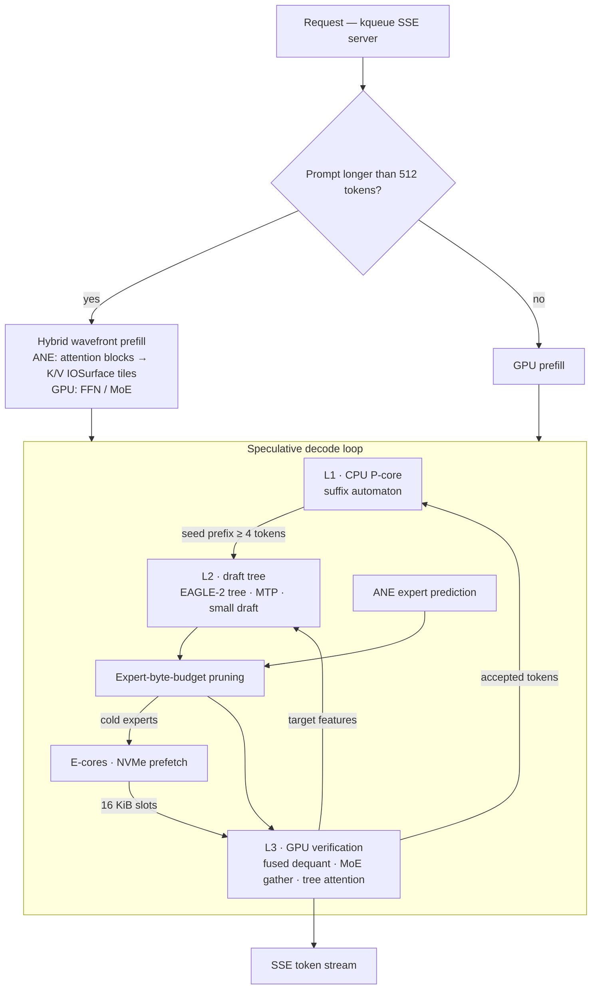

# Architecture overview

> Design reference. What is implemented today is tracked only in
> [../status.md](../status.md); progress is tracked only in
> [../process.md](../process.md).

## Goal

aminfer is a bare-metal, ultra-low-latency LLM inference engine for Apple
Silicon. It treats the SoC as one heterogeneous machine — CPU performance
cores, CPU efficiency cores, the Neural Engine (ANE), the GPU, wired DRAM and
the internal NVMe SSD — and keeps all of them busy on one zero-copy memory
pool. The aim is to break through the unified-memory wall: serve models that
are larger, or decode faster, than any single engine allows.

- **Baseline**: M4 with 24 GB of unified memory. Measured platform facts are in
  [hardware.md](hardware.md).
- **Scale-up**: 128 GB+ Max / Ultra machines without redesign — a larger wired
  budget, more bandwidth, wider draft trees.
- **Scale-out (future)**: expert parallelism across Macs over Thunderbolt; only
  the interface is reserved ([ADR-0003](../decisions/0003-expert-source-tagged-union.md)).

## Hardware roles

| Engine | Responsibilities |
| --- | --- |
| CPU P-cores | L1 suffix-automaton drafting with zero allocation; lock-free scheduling; dual-source tree merging and expert-byte-budget pruning |
| CPU E-cores | Asynchronous cold-expert prefetch from NVMe (`F_NOCACHE`, `aio_read` + `kqueue`) into 16 KiB-aligned ring slots |
| ANE | L2 drafting: the same-family small draft model and pipelined drafting; EAGLE / MTP heads when the benchmark gate selects the ANE; attention blocks of the hybrid chunked prefill; cross-layer MoE expert prediction |
| GPU (Metal) | L3: fused 3/4-bit dequantization and native FP16 / BF16 GEMV / GEMM, MoE expert gather and tree-attention verification; FFN / MoE half of the hybrid prefill; EAGLE / MTP heads when the gate selects the GPU |
| Wired DRAM | Hot experts, dense weights, KV tiles, activations and expert slots — 16 KiB aligned, `mlock`ed, inside the wired budget |
| NVMe SSD | Cold experts in `.amf` files; N-gram tables |
| Thunderbolt peer | Remote expert memory (future) |

Two platform facts shape these roles (details in [hardware.md](hardware.md)):

- **The ANE does not isolate bandwidth.** Its on-chip SRAM is megabyte-scale,
  so weights stream from DRAM through the same memory system the GPU uses. The
  ANE contributes parallel compute; the scheduler budgets DRAM bytes across all
  engines.
- **Cores are steered, not pinned.** macOS offers no hard CPU affinity on Apple
  Silicon; P-core and E-core placement is expressed through QoS classes.

## Request pipeline

The stages, their dependencies and what overlaps with what are described in
[runtime-pipeline.md](runtime-pipeline.md).

## Software layers

| Layer | Language | Location | Responsibility |
| --- | --- | --- | --- |
| Engine core | Zig 0.17.1 | `src/` | Scheduler, memory pools, lock-free rings, L1 suffix automaton, async I/O, kqueue SSE server, model execution plan |
| Hardware bridge | Objective-C (ARC) behind a pure C header | `src/bridge/` | The only code that calls Apple frameworks (Metal, CoreML, IOSurface, Foundation; CoreVideo where pixel-buffer-backed `MLMultiArray` requires it) |
| GPU kernels | Metal Shading Language | `src/kernels/` | Dequantization GEMV / GEMM, MoE gather, attention and tree attention |
| Offline tools | Python, managed by uv | `tools/` | `.amf` export, expert heat statistics, CoreML `.mlpackage` export |

The boundaries and the build graph are fixed by
[ADR-0001](../decisions/0001-language-and-toolchain-boundaries.md): Zig reads
the bridge through `b.addTranslateC` (Zig 0.17.1 removed `@cImport`), and
`build.zig` is the only build hub.

## Engineering invariants

1. **No Python in the inference runtime** — Python lives only in `tools/`
   ([ADR-0001](../decisions/0001-language-and-toolchain-boundaries.md)).
2. **No dynamic heap allocation on the hot path** — every tensor buffer, KV
   tile and ring slot is preallocated at startup through explicit Zig
   allocators; GPU encoding reuses Metal 4 command allocators and command
   buffers ([ADR-0002](../decisions/0002-page-alignment-and-zero-copy.md),
   [ADR-0011](../decisions/0011-metal4-zero-allocation-hot-path.md)).
3. **No implicit paging or swap** — hot weights and active buffers are wired
   with `mlock` inside a budget computed at startup
   ([ADR-0012](../decisions/0012-wired-memory-budget-headroom.md)).
4. **16 KiB page alignment** — `APPLE_PAGE_SIZE = 16384`; every buffer shared
   with Metal or through IOSurface has a 16 KiB-aligned start address and
   length, enforced by our code
   ([ADR-0002](../decisions/0002-page-alignment-and-zero-copy.md)).
5. **Zero-copy bridging** — CPU, ANE and GPU share physical pages; tensors are
   never copied between them
   ([ADR-0002](../decisions/0002-page-alignment-and-zero-copy.md),
   [ADR-0004](../decisions/0004-kv-cache-iosurface-texture-sharing.md)).
6. **Extensible expert storage** — `ExpertSource` is a tagged union
   (`local_wired_ram`, `local_nvme_ssd`, `thunderbolt_peer`)
   ([ADR-0003](../decisions/0003-expert-source-tagged-union.md)).
7. **Compile-time specialization** — quantization groups, MoE top-k and tree
   widths are specialized at compile time
   ([ADR-0014](../decisions/0014-compile-time-specialization.md)).
8. **No unapproved dependencies** — Zig `std` and native macOS APIs first
   ([ADR-0001](../decisions/0001-language-and-toolchain-boundaries.md)).
9. **macOS 26.0+ on Apple Silicon**
   ([ADR-0011](../decisions/0011-metal4-zero-allocation-hot-path.md)).

## Glossary

| Term | Meaning |
| --- | --- |
| L1 / L2 / L3 | Drafting by the CPU suffix automaton / drafting by EAGLE, MTP or a small draft model / verification by the target model on the GPU |
| Round | One draft–prune–verify–accept cycle of the decode loop |
| Hot path | Code that runs every round or every prefill chunk |
| Wired budget | Bytes aminfer pins in DRAM, computed at startup |
| KV tile | IOSurface-backed fp16 block of K or V for one layer and one prefill chunk |
| Slot | Preallocated 16 KiB-aligned buffer that receives a cold expert from NVMe |
| `.amf` | aminfer Model Format: 16 KiB-aligned weight and expert container |

## Document map

- [hardware.md](hardware.md) — measured platform facts, bandwidth and compute
  model, core steering
- [runtime-pipeline.md](runtime-pipeline.md) — prefill, decode loop, overlap,
  threading, hot-path rules
- [memory.md](memory.md) — page invariant, wired budget, residency, zero-copy
  paths, KV tiles, budget estimates
- [speculative-decoding.md](speculative-decoding.md) — L1 / L2 / L3, tree
  merging, expert-byte-budget pruning, verification
- [experts-and-storage.md](experts-and-storage.md) — `ExpertSource`, `.amf`,
  cold-expert I/O, expert prediction, Thunderbolt peer
- [model-roadmap.md](model-roadmap.md) — composable model axes and tiered
  roadmap (`Qwen3.8-Flash-Next`, `DeepSeek-V4.1-Flash-1017`)
- [../decisions/README.md](../decisions/README.md) — ADR index
